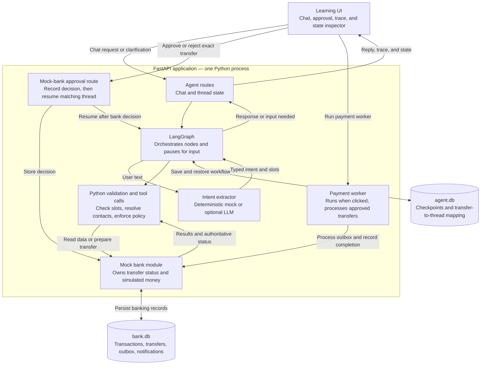
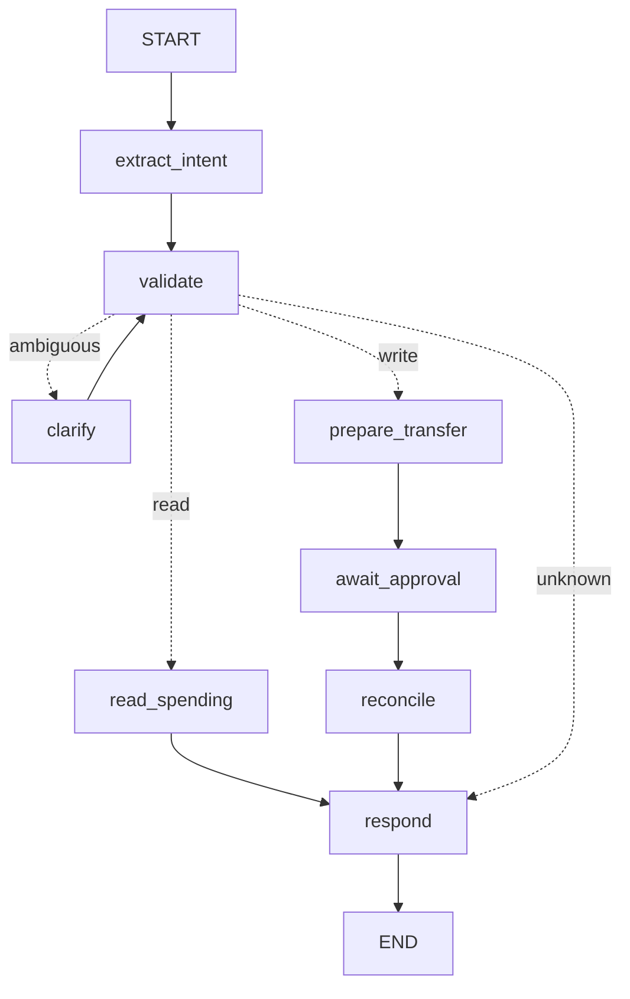

# LangGraph Banking Assistant — a learning app

A deliberately **small** LangGraph app for learning through the fictional banking mock case in
[`docs/mock_case.md`](docs/mock_case.md): a banking chat assistant that can
**summarise spending** (read) and **prepare transfers** (write) — with clarification,
human approval via `interrupt()`, checkpoints that survive a restart, and a mock bank that
stays the source of truth.

> Everything is fictional. No real bank, no real money, no API keys needed.

## Run it

```bash
uv sync
uv run uvicorn app.main:app --reload
# open http://127.0.0.1:8000
```

Tests and the offline evaluation:

```bash
uv run pytest -q                 # 19 tests, no network, no LLM
uv run python -m app.evaluation  # intent / slot / routing accuracy on labeled cases
```

Reset all demo data: stop the server and `rm -rf data/`.

## What's in the box (≈ 900 lines of Python, heavily commented)

```
app/
  graph.py        ← START HERE. State, nodes, edges, and the Assistant glue. The whole agent.
  bank.py         ← mock bank (SQLite): transactions, contacts, transfers, outbox, notifications
  extractor.py    ← the only "LLM" step: text -> typed Intent (deterministic mock by default)
  main.py         ← FastAPI routes (agent routes vs bank routes)
  evaluation.py   ← tiny offline eval runner
  static/index.html  ← one-file UI: chat, approval, bank, graph, trace, state, study notes
evaluation/labeled_cases.jsonl
tests/
docs/
  01-langgraph-concepts.md     ← vocabulary, mapped to lines in graph.py
  02-demo-walkthrough.md       ← click-by-click demos for every scenario
  step-by-step.html            ← interactive architecture guide (open in browser)
  03-design-tradeoffs.md       ← what's simplified vs a real system, and why
  mock_case.md                ← mock-case guide and design questions (Q01–Q33)
```

## Architecture for learners

**The LLM proposes, Python validates, the bank decides.** Follow a request from the
chat UI through the graph to the mock bank. The LLM extracts intent and slots;
Python controls routing, tool calls, and arithmetic.



For “Send Alex €500,” Python asks which Alex if several contacts match. The bank
then prepares a transfer without moving money. The graph pauses while the learner
approves or rejects the exact recipient and amount through the mock bank's approval
control. Approval resumes the matching thread; the payment worker completes the
simulated transfer when run.

The extractor is mocked by default, and replies use Python templates. The mock bank
runs in the same process; a production architecture could put it behind a separate
authenticated API. Checkpoints track workflow progress; banking records remain the
source of truth for transfer status.

## The graph



| Node | Kind | Job |
|---|---|---|
| `extract_intent` | LLM (mock by default) | words → `Intent{intent, categories, period, recipient_query, amount_minor}` |
| `validate` | Python | policy: missing/ambiguous slot? resolve recipient in the bank; pick a route |
| `clarify` | `interrupt()` | ask the user; resume with their answer; loop back to `validate` |
| `read_spending` | Python + bank | fixed query + deterministic sum |
| `prepare_transfer` | Python + bank | bank creates `PENDING_APPROVAL` transfer. No money moves |
| `await_approval` | `interrupt()` | wait until the **bank** records an approval |
| `reconcile` | Python + bank | re-read the real status from the bank |
| `respond` | Python template | final text, built from validated data |

## Suggested learning path

1. Read [`docs/01-langgraph-concepts.md`](docs/01-langgraph-concepts.md) with `app/graph.py` open next to it.
2. Start the app and do the demos in [`docs/02-demo-walkthrough.md`](docs/02-demo-walkthrough.md),
   watching the **trace** and **state inspector** panels.
3. Read [`docs/03-design-tradeoffs.md`](docs/03-design-tradeoffs.md).
4. Exercises at the end of the walkthrough (add a node, swap in a real LLM, swap SQLite → Postgres).

## Using a real LLM (optional)

```bash
uv sync --extra llm
export ANTHROPIC_API_KEY=...
EXTRACTOR=llm LLM_MODEL=anthropic:claude-haiku-5-5 uv run uvicorn app.main:app
EXTRACTOR=llm uv run python -m app.evaluation     # see how a real model scores
```

Any `provider:model` string supported by LangChain's `init_chat_model` works. Tests always use the mock.
